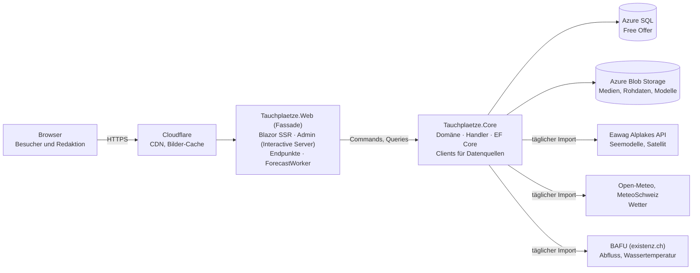

# Architektur und Coding Guidelines

## Prinzipien

- **Vertical Slices nach Fachlichkeit**, nicht Schichten nach Technik. Ein Use Case liegt an einem Ort: `Tauchplaetze.Core/Features/{Slice}/`.
- **CQS: Commands und Queries getrennt** (ADR-002). Eine Query hat **nie** Seiteneffekte. Ein Command hat in der Regel welche. Pro Use Case eine Datei in `Commands/` oder `Queries/` mit Record und Handler.
- **Core und Fassaden.** Nur `Tauchplaetze.Core` greift auf Datenbank, Blob Storage und externe Dienste (Alplakes, MeteoSchweiz, BAFU, Mail) zu. Nach aussen geht das nur über Commands und Queries. `Tauchplaetze.Web` ist eine Fassade: Seiten, Admin, HTTP-Endpunkte und der Host der Background Worker. Fachlogik oder Datenzugriff in einer Fassade ist ein Fehler. Architekturtests halten die Grenze fest.
- **Externe Quellen nie aus einer Anfrage.** Der Worker importiert. Seiten lesen die eigene Datenbank.
- **Einfach vor clever.** Kein MediatR, kein Repository-Pattern über EF Core, kein Event-Bus. Handler sprechen direkt mit dem `DbContext`.

Die Konventionen entsprechen den Projekten **feldnah** und **bau-ticker**.

## Systemübersicht



## Stack

| Bereich | Technologie |
|---|---|
| Laufzeit | .NET 10 (LTS) |
| Web | ASP.NET Core, Blazor Web App |
| Render-Modi | Static SSR (öffentlich), Interactive Server (Admin) – ADR-001 |
| UI öffentlich | eigenes CSS mit Design Tokens (`design-system.md`), CSS Isolation, kein Komponenten-Framework |
| UI Admin | MudBlazor mit dunklem Theme aus denselben Tokens |
| Karten | Leaflet über schlanken JS-Interop bzw. statisches Einbinden |
| Daten | EF Core 10, SQL Server Provider, NetTopologySuite |
| Datenbank | Azure SQL Database, Free Offer – ADR-003 |
| Storage | Azure Blob Storage (Medien, Rohdaten, ML-Modelle) |
| Bilder | ImageSharp (Grössen, WebP) |
| HTTP-Clients | `IHttpClientFactory` mit `Microsoft.Extensions.Http.Resilience` |
| Auth | ASP.NET Core Identity, Cookie, Passkeys |
| Lokale Entwicklung | .NET Aspire (`Tauchplaetze.AppHost`) mit SQL Server und Azurite im Container |
| Observability | OpenTelemetry über `ServiceDefaults`, Application Insights in Produktion |
| ML (Phase 2) | ML.NET mit LightGBM |
| Tests | xUnit v3 (Microsoft Testing Platform), Testcontainers (MsSql), Mono.Cecil und Roslyn (Regeltests) |

## Projektstruktur

```
src/
├── Tauchplaetze.slnx
├── Tauchplaetze.Core/              Domäne, Handler, Infrastruktur – einziger Zugang zu DB, Storage, externen Diensten
│   ├── Features/
│   │   └── {Slice}/
│   │       ├── Commands/           ein Use Case je Datei: Command-Record + Handler (+ Result)
│   │       ├── Queries/            ein Use Case je Datei: Query-Record + Handler, ohne Seiteneffekte
│   │       ├── {Slice}Dtos.cs      Ergebnis-Typen, die Fassaden sehen
│   │       ├── {Slice}Module.cs    Registrierung des Slice (ICoreModule)
│   │       └── …                   Domänenlogik des Slice (internal)
│   ├── Data/
│   │   ├── TauchplaetzeDbContext.cs
│   │   ├── Entities/
│   │   ├── Configurations/         IEntityTypeConfiguration je Entität
│   │   └── Migrations/
│   └── CrossCutting/
│       ├── UseCases/               ICommandHandler, IQueryHandler, Unit, HandlerRegistration
│       ├── Modules/                ICoreModule, Assembly-Scan
│       ├── Storage/                Blob-Zugriff (IMediaStorage, IRawDataStorage)
│       ├── Locks/                  Sperre für Jobs
│       └── Time/                   TimeProvider, Lokalzeit Europe/Zurich
├── Tauchplaetze.Web/               Fassade: Blazor-Seiten, Admin, Endpunkte, Worker-Host
│   ├── Components/                 App.razor, Routes.razor, Layouts (PublicLayout, AdminLayout)
│   ├── Features/
│   │   └── {Slice}/                Seiten (.razor), Komponenten, Endpunkte, Worker des Slice
│   ├── Localization/               *.resx, *.en.resx, *.fr.resx, *.it.resx
│   ├── wwwroot/                    tokens.css, base.css, Schriften, Icons
│   └── Program.cs
├── Tauchplaetze.ServiceDefaults/   OpenTelemetry, Health Checks, Resilience (Aspire-Standard)
├── Tauchplaetze.AppHost/           Aspire: Web, SQL Server, Azurite
├── Tauchplaetze.Core.Tests/        Unit- und Integrationstests der Handler, ArchitectureTests
└── Tauchplaetze.Web.Tests/         Tests der Fassade (Routing, Lokalisierung, Endpunkte)
```

Später möglich: `Tauchplaetze.Cli` als zweite Fassade (Import, Training des Modells, Smoke Tests). Wie bei bau-ticker.

## Slices

| Slice | Core (Handler, internal) | Web (Fassade) |
|---|---|---|
| `DiveSites` | Queries `GetDiveSites`, `GetDiveSite` (mit Weiterleitung bei altem Slug), `GetDiveSitesNearby`, `ResolveSlug`, `GetPublicRevisions`, `ComparePublicRevisions` | Seiten Verzeichnis, Tauchplatz, Karte |
| `WaterBodies` | Command `SeedWaterBodies`; Queries `GetWaterBodies`, `GetWaterBody`, `GetWaterBodyConditions` | Gewässerseite, Gewässer-Übersicht |
| `Forecasts` | Commands `RunForecast`, `RecalculateForecast` (später); Queries `GetSiteForecast`, `GetBestSites`, `GetForecastStatus`; Quellen `ForecastSources` mit `SourceRecorder` (Rohdaten, Status pro Call); Rechenkern `DiveIndexCalculator`, `ThermoclineDetector`, `DataLevelRule`; Clients `AlplakesClient`, `OpenMeteoClient`, `SwissMetNetClient`, `HydroClient` | Startseite «Wo tauchen?», `ForecastWorker` (BackgroundService, ruft `RunForecast`) |
| `Editorial` | Commands `ImportDiveSites`, `ProposeDiveSite`, `ProposeChange`, `WithdrawRevision`, `ApproveRevision`, `RejectRevision`, `RedactRevision`, `ArchiveDiveSite`, `RestoreRevision`, `UploadMedia`; Queries `GetDiveSitesForEditing`, `GetDiveSiteForEditing`, `GetPendingRevisions`, `GetRevisions`, `CompareRevisions`, `GetMyContributions`; Speicher der Versionen in Blob Storage (`IRevisionStore`) | CMS unter `/admin` für Mitwirkende, Moderatoren und Admins |
| `Media` | Queries `GetMediaVariant`; Bildverarbeitung | Endpunkt für Bildauslieferung (falls nicht direkt aus Blob) |
| `Accounts` | Identity-Store, Commands `Register`, `ConfirmEmail`, `UpdateProfile`, `AssignRole`, `BlockAccount`, `DeleteAccount`, `EnsureAdmins`; Query `GetPersonalData` | Login, Registrierung, Passkeys, Profil, «Meine Daten» mit Download |
| `Reports` (Phase 1) | Commands `SubmitReport`, `HideReport`; Queries `GetReports` | Meldeformular, Admin-Liste |
| `DiveShops` (Phase 1) | Commands, Queries für Tauchshops und Füllstationen | Admin-Seiten, Anzeige auf Platzseite |
| `BuddyGroups` (Phase 1) | Commands, Queries | Admin-Seiten, Links |
| `Seo` | Queries `GetSitemapEntries` | `sitemap.xml`, `robots.txt`, Redirects |
| `Operations` | Command `MigrateDatabase` | Start der Web-App (`Database:PrepareOnStartup`, lokal mit Aspire) |

Derselbe Slice-Name in Core und Web meint dasselbe Thema.

## Ein Use Case

Contracts in `Tauchplaetze.Core/CrossCutting/UseCases`:

```csharp
namespace Tauchplaetze.Core.CrossCutting.UseCases;

public interface ICommandHandler<in TCommand, TResult>
{
    Task<TResult> Handle(TCommand command, CancellationToken ct = default);
}

public interface IQueryHandler<in TQuery, TResult>
{
    Task<TResult> Handle(TQuery query, CancellationToken ct = default);
}

public readonly record struct Unit
{
    public static readonly Unit Value = new();
}
```

Eine Query (`Features/DiveSites/Queries/GetDiveSitesNearby.cs`):

```csharp
namespace Tauchplaetze.Core.Features.DiveSites.Queries;

public record GetDiveSitesNearbyQuery(double Latitude, double Longitude, int RadiusKm, DateOnly Date);

internal class GetDiveSitesNearbyHandler(TauchplaetzeDbContext dbContext)
    : IQueryHandler<GetDiveSitesNearbyQuery, IReadOnlyList<DiveSiteRankingDto>>
{
    public async Task<IReadOnlyList<DiveSiteRankingDto>> Handle(GetDiveSitesNearbyQuery query, CancellationToken ct = default)
    {
        var origin = GeoPoint.Create(query.Latitude, query.Longitude);

        return await dbContext.DailyForecasts
            .Where(f => f.Date == query.Date)
            .Where(f => f.DiveSite.Status == DiveSiteStatus.Published)
            .Where(f => f.DiveSite.Location.IsWithinDistance(origin, query.RadiusKm * 1000))
            .OrderByDescending(f => f.DiveIndex)
            .Select(f => new DiveSiteRankingDto(/* … */))
            .ToListAsync(ct);
    }
}
```

Ein Command (`Features/Editorial/Commands/CreateDiveSite.cs`):

```csharp
namespace Tauchplaetze.Core.Features.Editorial.Commands;

public record CreateDiveSiteCommand(string Name, int WaterBodyId, double Latitude, double Longitude, string EditorId);

public record CreateDiveSiteResult(Guid Id, string Slug);

internal class CreateDiveSiteHandler(TauchplaetzeDbContext dbContext, TimeProvider time)
    : ICommandHandler<CreateDiveSiteCommand, CreateDiveSiteResult>
{
    public async Task<CreateDiveSiteResult> Handle(CreateDiveSiteCommand command, CancellationToken ct = default)
    {
        // Validate, create entity, compute content level, write revision 1, save.
    }
}
```

Regeln:

- Datei- und Klassenname: `{UseCase}.cs` enthält `{UseCase}Command` bzw. `{UseCase}Query`, `{UseCase}Handler` und optional `{UseCase}Result`.
- Namespaces: `Tauchplaetze.Core.Features.{Slice}.Commands` und `Tauchplaetze.Core.Features.{Slice}.Queries`.
- **Handler sind `internal`.** Die Fassade injiziert den Contract (`IQueryHandler<GetDiveSitesNearbyQuery, IReadOnlyList<DiveSiteRankingDto>>`).
- Commands tragen die Benutzer-ID als Wert (`string EditorId`), nicht den `ClaimsPrincipal`.
- Ein fachlich erwarteter Fehler ist ein Ergebnis (z.B. `NotFound`, `Conflict`), keine Exception.
- `AddHandlers()` registriert alle Handler des Core per Assembly-Scan. Jeder Slice registriert seine übrigen Dienste in `{Slice}Module.cs` (`ICoreModule`). Ein neuer Slice ändert keine zentrale Datei.

### Geteilte Logik

Logik, die mehrere Handler eines Slice brauchen, liegt als `internal` Klasse im Slice-Ordner (z.B. `DiveIndexCalculator`, `ContentLevelRule`). Logik, die mehrere Slices brauchen, liegt in `CrossCutting`. Kein «Shared»-Projekt für Fachlogik.

## Render-Modi

| Bereich | Modus | Begründung |
|---|---|---|
| Öffentliche Seiten | Static SSR, Enhanced Navigation, Streaming Rendering | SEO, schnell, cachebar, keine Verbindung pro Besucher |
| Tagesauswahl, Filter | Links mit Query-Parametern (`?date=2026-10-18`) | bleibt SSR, jede Variante ist cachebar und teilbar |
| Karten, Galerie | kleines JavaScript-Modul, progressiv | kein WASM nötig |
| CMS `/admin` | Interactive Server | reiche Editoren ohne JS-Framework. Auch Mitwirkende arbeiten hier. Es bleiben wenige gleichzeitige Verbindungen. |
| Login | Static SSR mit Formular | Identity-Standard |

Interactive WebAssembly ist bewusst nicht vorgesehen. Wird es später nötig, kommt ein Projekt `Tauchplaetze.Web.Client` dazu.

## Caching

- **Output Cache** für öffentliche Seiten: Standard 15 Minuten. Tags `forecast`, `site:{id}`, `water:{id}`.
- Der Prognose-Lauf invalidiert `forecast`. Eine Speicherung im CMS invalidiert `site:{id}` und `water:{id}`.
- Variation nach Kultur und Query-Parametern (Tag, Umkreis).
- Bilder: lange Cache-Dauer (`immutable`), Dateiname enthält die Version. Cloudflare cacht vor dem App Service.
- Nebeneffekt: Die Datenbank bekommt wenig Anfragen. Das schont das Free Offer (vCore-Sekunden) und erlaubt Auto-Pause.

## Background Worker

- `ForecastWorker` (BackgroundService) im Web-Host. Er enthält nur Zeitplan und Aufruf des Commands `RunForecast`.
- Ein Lauf hält eine Sperre (Blob Lease). Mehrere Instanzen laufen nie gleichzeitig.
- App Service muss «Always On» haben (B1 erlaubt das), sonst schläft der Worker ein.

## Konfiguration und Secrets

- Lokal: User Secrets und Aspire.
- Produktion: App-Service-Einstellungen. Zugriff auf SQL und Blob über **Managed Identity** (Entra-Authentifizierung), keine Passwörter im Connection String.
- Secrets nie im Repository.
- Optionen typisiert (`IOptions<T>`) und beim Start validiert (`ValidateOnStart`).
- Settings mit Defaults im Code **und** in `appsettings.json`. Ein Test hält beide gleich. Im Betrieb überschreibbar als App Setting (`Section__Key`).

## Fehler und Edge Cases

- Ein Command validiert seine Eingabe selbst. Ungültige Eingabe ergibt ein Ergebnis mit Fehlern, keine Exception.
- **Leer ist nicht dasselbe wie unbekannt.** Ein fehlender Wert (`null`) heisst «nicht erhoben» oder «keine Daten». Eine leere Liste heisst «keins». Beides wird unterschieden, gespeichert und getestet. Bei der Prognose ist ein fehlender Messwert nie `0`.
- **Nicht raten.** Lässt sich ein Wert nicht zuverlässig bestimmen, bleibt er leer. Lieber eine Lücke als eine falsche Angabe.
- **Datenalter zeigen.** Ein alter Wert erscheint nie als aktueller.
- Failures externer Services halten den Betrieb nicht an, werden aber sichtbar (Log, Status des Laufs im Admin). Der Lauf schreibt einen Teilerfolg. Die Seite zeigt das Datenalter.
- Unbekannter Slug: zuerst `SlugRedirects` prüfen (301), sonst 404.

## Coding Guidelines

### Sprache

| Ebene | Sprache |
| :-- | :-- |
| Bezeichner, Typen, Felder, API, Log-Meldungen | Englisch |
| Kommentare, Specs, ADRs, README, Commit-Nachrichten | Deutsch (Schweizer Schreibweise, «ss»), IT-Begriffe englisch |
| Oberfläche | aus `.resx` in DE, EN, FR, IT (siehe `i18n.md`) |
| `AGENTS.md` | Englisch in ASD-STE100 |
| Gespräch mit Marc im Chat | Deutsch |

Entscheid Marc, 17.10.2026: Kommentare und Commits deutsch wie bei bau-ticker (offener Punkt #15 erledigt).

Fachbegriffe übersetzt man nicht frei, sondern nach [ubiquitous-language.md](ubiquitous-language.md).

**IT-Begriffe englisch im Original.** Im deutschen Fliesstext von Kommentaren, Specs, ADRs, README und Commit-Nachrichten stehen IT-Begriffe so, wie die Fachwelt sie nennt, nicht eingedeutscht. Also Storage (bzw. konkret Blob, Container), Cache, Queue, Lock, Run, Query, API bzw. Interface, Timestamp, Raw Data, Retry, Backfill, Call, Key, Row, Column, Deployment, Contract und Contract Test, Background Service, Output Cache. Nicht «Ablage», «Zwischenspeicher», «Warteschlange», «Sperre», «Abfrage», «Schnittstelle», «Zeitstempel», «Rohdaten», «Wiederholung» (eines Calls), «Aufruf», «Schlüssel», «Zeile», «Spalte», «Vertrag», «Hintergrunddienst». **Deutsch bleiben** die eingebürgerten Wörter Domäne, Datensatz, Datenbank, Verbindung, Dienst, Abruf, Lauf (des Prognose-Jobs) und alle Fachbegriffe aus `ubiquitous-language.md` (Tauchplatz, Sprungschicht, Tauch-Index, Ausbaustufe, Datenstufe …). Was Oberfläche ist, folgt `i18n.md` und `ux.md`.

Razor-Komponenten und Seiten heissen englisch (`DiveSitePage`, `ForecastRanking`). Die **URLs** folgen `seo.md`.

### C#

- Microsoft-Konventionen, moderne C#-Features (Records, Primary Constructors, Collection Expressions, Pattern Matching).
- **Kein `Async`-Suffix:** `GetAll()`, nicht `GetAllAsync()`. Ausgenommen sind Framework Contracts, die den Namen vorgeben.
- Felder in camelCase ohne `_`-Präfix, statische Felder und Konstanten PascalCase (IDE1006, im Build erzwungen).
- **Geschweifte Klammern bei `if`/`else` immer**, auch bei Einzeilern (IDE0011, im Build erzwungen).
- `TreatWarningsAsErrors`, `Nullable` und Code-Stil im Build sind an (`Directory.Build.props`, `.editorconfig`). Ein überflüssiges `using` ist ein Fehler.
- Package Versions zentral in `Directory.Packages.props`.
- `CancellationToken ct` wird durchgereicht.

### Code-Dokumentation

- **Der Code ist die Dokumentation.** Namen, Typen und kleine Methoden sagen, was geschieht. Was sich aus dem Code lesen lässt, wird nicht noch einmal beschrieben.
- **Im Zweifel «Extract Method» statt Kommentar.** Braucht ein Block eine Erklärung, wird er zu einer Methode, deren Name sagt, *was* sie tut – nicht *wie*: `IsStale(observation)` statt eines Kommentars «prüft, ob der Satellitenwert älter als 14 Tage ist» über drei Zeilen Datumsrechnung.
- **Wenn dokumentiert wird, dann mit XML-Doc** (`///` mit `<summary>`, wo sinnvoll `<param>`, `<returns>`, `<remarks>`, `<see cref="…"/>`), damit es in der Code Completion erscheint. Nicht wiederholen, was der Name sagt, sondern das Warum, nicht offensichtliche Randbedingungen und verwandte Typen.

  | Element | XML-Doc |
  | :-- | :-- |
  | Interfaces und ihre Members | **Pflicht** – dort gibt es keinen Code, der erklärt |
  | `public` und `protected` | optional – wo der Name allein nicht reicht |
  | `private` und `internal` | nicht erwartet – der Code ist die Erklärung |
- **Kommentare sind die Ausnahme.** Im Zweifel kein Kommentar. Design, Geschichte und Alternativen gehören in Specs und ADRs, nicht in den Code.
- **Nur mit echtem Mehrwert, so kurz wie möglich.** Ein Kommentar sagt, was der Code nicht zeigen kann: eine Eigenheit einer externen API, ein Fall aus dem Betrieb, eine bewusst verworfene Alternative. In der Regel ein Satz, bevorzugt im `<remarks>` des Members.
- Belege mit Datum, wo eine Regel aus einem echten Fall stammt («Spike 17.10.2026: …»), und Verweise auf ADR oder Spec-Abschnitt statt sie zu wiederholen.
- **Keine Kommentare in Method Bodies** im Produktivcode. Ausgenommen sind Tests (`// Arrange` …), Migrations, erzeugter Code und Anweisungen an Werkzeuge (`// language=regex`, `// ReSharper disable`). Ein Regeltest (Roslyn) prüft es.

### Schreiben

Gilt für Kommentare, Specs, ADRs, README und Commit-Nachrichten.

- **Deutsch nach den Grundsätzen von ASD-STE100:** kurze Sätze, eine Aussage pro Satz, Aktiv statt Passiv, keine Füllwörter. Keine Gedankenstriche oder Semikolons, die zwei Aussagen verbinden: zwei Sätze schreiben.
- **Die Stärke einer Anforderung bleibt:** «muss», «soll» und «kann» nicht gegeneinander tauschen.
- **Englischen Text in ASD-STE100** (Simplified Technical English) schreiben, mit dem Skill in [`.claude/skills/asd-ste100/`](../.claude/skills/asd-ste100/SKILL.md).
- Oberflächentexte folgen `ux.md` und `i18n.md`, nicht diesem Abschnitt.

### Commits und Pull Requests

- **Format nach [Conventional Commits](https://www.conventionalcommits.org/):** `typ(bereich): Beschreibung`, etwa `feat(forecasts): Sprungschicht aus dem Profil bestimmen`. Typen: `feat`, `fix`, `docs`, `refactor`, `test`, `build`, `ci`, `chore`. Der Bereich ist der Slice-Name in Kleinbuchstaben (`forecasts`, `divesites`, `editorial` …) oder ein Querschnitt (`specs`, `agents`, `infra`).
- **Der PR-Titel folgt demselben Format.** Beim Squash-Merge wird er zum Commit-Titel auf `main`.
- **Die Beschreibung des PR wird zur Commit-Nachricht.** Darum kurz: wenige Sätze, was sich ändert und warum. Kein HTML, keine Links oder Verweise auf Claude, keine Sitzungs-IDs, kein `Co-Authored-By`. Einzelheiten gehören in die Specs.
- Die Sprache folgt dem Abschnitt «Schreiben»: Deutsch, IT-Begriffe englisch.
- Vor jedem Push läuft der Review (`.claude/skills/review/`).

## Testing

### Was getestet wird

- **Ein Test muss sich lohnen.** Getestet wird, wo das Prüfen von Logik einen echten Nutzen bringt: Er fängt einen Fehler, den man sonst erst im Betrieb sähe, oder hält eine Regel fest, die leicht unbemerkt bricht. Coverage ist kein Ziel.
- **Kein Test doppelt.** Vor einem neuen Test prüfen, ob die Regel schon getestet ist. Derselbe Fall nicht auf mehreren Ebenen (Handler, HTTP), ausser die Ebene zeigt etwas Eigenes (HTTP: Anmeldung, Routing, Sprachpräfix, Output Cache). Varianten derselben Regel als Theory. Asserts auf sichtbaren Text oder `data-`-Attribute, nicht auf CSS-Klassen und Markup.
- **Black-Box-Tests.** Das System under Test (SUT) wird über seine öffentliche API getestet. Für die erwarteten Fälle wird der Input gegeben und der erwartete Output geprüft. Keine Prüfung interner Zustände, privater Members oder der Reihenfolge interner Calls. So überlebt ein Test jedes Refactoring, das das Verhalten nicht ändert.
- **Was ist das SUT?** Getestet wird, was die Regel trägt: ein Use Case oder ein einzelner Baustein.
  - **Ein Use Case** wird über seinen Handler oder über HTTP getestet.
  - **Eine `internal` Klasse darf direkt getestet werden, wenn sie selbst das SUT ist**, etwa `DiveIndexCalculator`, `ThermoclineDetector`, `ContentLevelRule` oder ein Parser einer Datenquelle. Dafür gibt es `InternalsVisibleTo`. Auch dann gilt Black-Box.
  - **Arrange und Assert dürfen die Datenbank direkt nutzen**, wenn die Regel den gespeicherten Zustand betrifft (Idempotenz: «ein zweiter Lauf schreibt keine zweite Row», Revisionen) oder wenn sich die Ausgangslage über keinen Command herstellen lässt (ein Prognose-Lauf von gestern, ein alter Snapshot).
  - **Sonst über Commands und Queries.**
- **Verhalten, nicht Mapping.** Keine Tests, die nur Eigenschaften durchreichen oder einen Mock Call zählen. Getestet wird ein Mapping erst, wenn es entscheidet (Fallbacks, Umrechnungen wie m/s in Bft, Regeln wie «leer ist nicht unbekannt»).
- **Lohnt sich:** Tauch-Index und Teilwerte, Sprungschicht-Erkennung, Datenstufe und Ausbaustufe, Revisionen und Wiederherstellen, Slug-Redirects, Umkreissuche, Fallback der Sprachen, Verhalten bei fehlenden oder alten Daten, Parser mit **echten Antworten** der Quellen als Fixtures.
- **Ein Fehler, der einmal vorkam, bekommt einen Test**, der ihn beim Namen nennt.
- **Arrange / Act / Assert** als Kommentare (`// Arrange`, `// Act`, `// Assert`) trennen die drei Phasen jeder Testmethode. Tests ohne Setup dürfen `// Arrange` weglassen. Ist die erwartete Exception die Assertion, ist `// Act & Assert` zulässig. Prüft ein Test eine Abfolge, dürfen sich `// Act` und `// Assert` wiederholen. Eine Begründung steht über `// Arrange`, nicht im Phasenkommentar.
- **Test-Namen sind deutsche Sätze**, die die Regel aussprechen: `Ohne_Satellitenwert_der_letzten_14_Tage_ist_die_Klarheit_unbekannt` (Umlaute als ae/oe/ue).

### Aufbau

- **xUnit** mit `Assert`. **Keine Mocking Library.** Stattdessen kleine handgeschriebene Test Doubles (z.B. ein `HttpMessageHandler`, der gespeicherte Antworten liefert, ein fester `TimeProvider`).
- Reine Logik (Rechner, Regeln, Parser): Unit Tests ohne Datenbank.
- **Handler mit Datenbank: Testcontainers mit SQL Server.** Grund: Geodaten (`geography`) und die Umkreissuche laufen nicht im InMemory-Provider. Ein Container je Testlauf (Collection Fixture). Das Schema entsteht über die echten **Migrationen**. Vor jedem Test leert ein Reset alle Tabellen. Ein Test prüft, dass das Modell dem letzten Migrations-Snapshot entspricht (`HasPendingModelChanges`).
- **Ohne Docker** werden die SQL-Tests lokal sichtbar **übersprungen** (mit Grund), nicht still grün. In der CI (`CI=true`) wird nie übersprungen.
- **Integration Tests** der Fassade starten die App In-Memory (`Microsoft.AspNetCore.Mvc.Testing`) und prüfen über HTTP: Routing, Sprachpräfix, gerendertes HTML, Anmeldung.
- **Datenquellen:** Contract Tests mit gespeicherten echten Antworten (`TestData/{quelle}/*.json`). Kein Test ruft eine echte externe Quelle auf.
- **ArchitectureTests** (jede Regel mit Gegenbeispiel, das anschlagen muss), in drei Schichten:
  1. **Compiler:** Entitäten, `DbContext` und Handler sind `internal`. Ein Test prüft, dass nichts in `Tauchplaetze.Core.Data` öffentlich ist (ausser Migrationen).
  2. **Mono.Cecil:** `Tauchplaetze.Web` referenziert kein Assembly der Infrastruktur (EF Core, `Microsoft.Data.SqlClient`, `Azure.*`, NetTopologySuite). Query-Handler rufen kein `SaveChanges`, `ExecuteUpdate` oder `ExecuteDelete`, auch nicht im vom Compiler erzeugten Typ eines `async`-Handlers.
  3. **Reflection und Roslyn:** Handler liegen in `Commands/` bzw. `Queries/`. Jede Datei dort enthält genau einen passenden Handler.
  - Entscheid 17.10.2026: kein ArchUnitNET. Die Regeln oben brauchen es nicht. ArchUnitNET sieht Zugriffe in `async`-Methoden nicht zuverlässig (Erfahrung aus bau-ticker).
- **Regeltests im Code:** keine Kommentare in Method Bodies (Roslyn), `// Arrange` `// Act` `// Assert` in jeder Testmethode, gleiche Keys in allen vier `.resx`-Sätzen, Defaults im Code gleich wie in `appsettings.json`.

### Bibliotheken

| Bibliothek | Zweck |
|---|---|
| xUnit | Test-Framework und Assertions |
| Testcontainers.MsSql | echte Datenbank in Tests |
| Microsoft.AspNetCore.Mvc.Testing | Integration Tests der Fassade |
| Mono.Cecil | Architekturregeln (Assembly-Referenzen, Methodenrümpfe) |
| Microsoft.CodeAnalysis (Roslyn) | Regeltests im Code |
| bUnit | Komponenten-Tests der Fassade (sparsam) |

### Ausführen

```bash
cd src
dotnet build
dotnet test --no-build
```

### Build vor dem Prüfen

- Vor einem Push **sauber bauen**: `find . -maxdepth 3 -type d \( -name obj -o -name bin \) -exec rm -rf {} + && dotnet build` in `src`. Ein inkrementeller Build kann Razor-Fehler verdecken (Erfahrung aus bau-ticker, 03.10.2026).
- Aspire baut die Web-App beim Neustart nicht neu. Erst `dotnet build`, dann neu starten.
