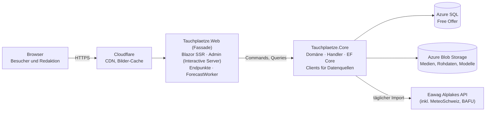

# Architektur und Coding Guidelines

## Prinzipien

- **Vertical Slices nach Fachlichkeit**, nicht Schichten nach Technik. Ein Use Case liegt an einem Ort: `Tauchplaetze.Core/Features/{Slice}/`.
- **CQS: Commands und Queries getrennt** (ADR-002). Eine Query hat **nie** Seiteneffekte. Ein Command hat in der Regel welche. Pro Use Case eine Datei in `Commands/` oder `Queries/` mit Record und Handler.
- **Core und Fassaden.** Nur `Tauchplaetze.Core` greift auf Datenbank, Blob Storage und externe Dienste (Alplakes, MeteoSchweiz, BAFU, Mail) zu. Nach aussen geht das nur über Commands und Queries. `Tauchplaetze.Web` ist eine Fassade: Seiten, Admin, HTTP-Endpunkte und der Host der Background Worker. Fachlogik oder Datenzugriff in einer Fassade ist ein Fehler. Architekturtests halten die Grenze fest.
- **Externe Quellen nie aus einer Anfrage.** Der Worker importiert. Seiten lesen die eigene Datenbank.
- **Einfach vor clever.** Kein MediatR, kein Repository-Pattern über EF Core, kein Event-Bus. Handler sprechen direkt mit dem `DbContext`.

Die Konventionen entsprechen den Projekten **feldnah** und **bau-ticker**.

## Systemübersicht



## Stack

| Bereich | Technologie |
|---|---|
| Laufzeit | .NET 10 (LTS) |
| Web | ASP.NET Core, Blazor Web App |
| Render-Modi | Static SSR (öffentlich), Interactive Server (Admin) – ADR-001 |
| UI öffentlich | eigenes CSS mit Design Tokens (`design-system.md`), CSS Isolation, kein Komponenten-Framework |
| UI Admin | MudBlazor mit dunklem Theme aus denselben Tokens |
| Karten | Leaflet über schlanken JS-Interop bzw. statisches Einbinden |
| Daten | EF Core 10, SQL Server Provider, NetTopologySuite |
| Datenbank | Azure SQL Database, Free Offer – ADR-003 |
| Storage | Azure Blob Storage (Medien, Rohdaten, ML-Modelle) |
| Bilder | ImageSharp (Grössen, WebP) |
| HTTP-Clients | `IHttpClientFactory` mit `Microsoft.Extensions.Http.Resilience` |
| Auth | ASP.NET Core Identity, Cookie, Passkeys |
| Lokale Entwicklung | .NET Aspire (`Tauchplaetze.AppHost`) mit SQL Server und Azurite im Container |
| Observability | OpenTelemetry über `ServiceDefaults`, Application Insights in Produktion |
| ML (Phase 2) | ML.NET mit LightGBM |
| Tests | xUnit, Shouldly, NSubstitute, Testcontainers (MsSql), ArchUnitNET |

## Projektstruktur

```
src/
├── Tauchplaetze.slnx
├── Tauchplaetze.Core/              Domäne, Handler, Infrastruktur – einziger Zugang zu DB, Storage, externen Diensten
│   ├── Features/
│   │   └── {Slice}/
│   │       ├── Commands/           ein Use Case je Datei: Command-Record + Handler (+ Result)
│   │       ├── Queries/            ein Use Case je Datei: Query-Record + Handler, ohne Seiteneffekte
│   │       ├── {Slice}Dtos.cs      Ergebnis-Typen, die Fassaden sehen
│   │       ├── {Slice}Module.cs    Registrierung des Slice (ICoreModule)
│   │       └── …                   Domänenlogik des Slice (internal)
│   ├── Data/
│   │   ├── TauchplaetzeDbContext.cs
│   │   ├── Entities/
│   │   ├── Configurations/         IEntityTypeConfiguration je Entität
│   │   └── Migrations/
│   └── CrossCutting/
│       ├── UseCases/               ICommandHandler, IQueryHandler, Unit, HandlerRegistration
│       ├── Modules/                ICoreModule, Assembly-Scan
│       ├── Storage/                Blob-Zugriff (IMediaStorage, IRawDataStorage)
│       ├── Locks/                  Sperre für Jobs
│       └── Time/                   TimeProvider, Lokalzeit Europe/Zurich
├── Tauchplaetze.Web/               Fassade: Blazor-Seiten, Admin, Endpunkte, Worker-Host
│   ├── Components/                 App.razor, Routes.razor, Layouts (PublicLayout, AdminLayout)
│   ├── Features/
│   │   └── {Slice}/                Seiten (.razor), Komponenten, Endpunkte, Worker des Slice
│   ├── Localization/               *.resx, *.en.resx, *.fr.resx, *.it.resx
│   ├── wwwroot/                    tokens.css, base.css, Schriften, Icons
│   └── Program.cs
├── Tauchplaetze.ServiceDefaults/   OpenTelemetry, Health Checks, Resilience (Aspire-Standard)
├── Tauchplaetze.AppHost/           Aspire: Web, SQL Server, Azurite
├── Tauchplaetze.Core.Tests/        Unit- und Integrationstests der Handler, ArchitectureTests
└── Tauchplaetze.Web.Tests/         Tests der Fassade (Routing, Lokalisierung, Endpunkte)
```

Später möglich: `Tauchplaetze.Cli` als zweite Fassade (Import, Training des Modells, Smoke Tests). Wie bei bau-ticker.

## Slices

| Slice | Core (Handler, internal) | Web (Fassade) |
|---|---|---|
| `DiveSites` | Queries `GetDiveSites`, `GetDiveSite`, `GetDiveSitesNearby`, `ResolveSlug` | Seiten Verzeichnis, Tauchplatz, Karte |
| `Lakes` | Queries `GetLakes`, `GetLake`, `GetLakeConditions` | Seeseite, Seen-Übersicht |
| `Forecasts` | Commands `RunForecast`, `RecalculateForecast`; Queries `GetBestSites`, `GetSiteForecast`, `GetForecastStatus`; Rechenkern `DiveIndexCalculator`, `ThermoclineDetector`; Clients `AlplakesClient` | Startseite «Wo tauchen?», `ForecastWorker` (BackgroundService, ruft `RunForecast`) |
| `Editorial` | Commands `CreateDiveSite`, `UpdateDiveSite`, `PublishDiveSite`, `ArchiveDiveSite`, `RestoreRevision`, `UploadMedia`, `UpdateMedia`, `ReorderMedia`, `DeleteMedia`; Queries `GetDiveSitesForEditing`, `GetDiveSiteForEditing`, `GetRevisions`, `CompareRevisions` | Admin-Seiten unter `/admin` |
| `Media` | Queries `GetMediaVariant`; Bildverarbeitung | Endpunkt für Bildauslieferung (falls nicht direkt aus Blob) |
| `Accounts` | Identity-Store, Commands `InviteEditor`, `EnsureAdmins` | Login, Passkeys, Einladung |
| `Reports` (Phase 1) | Commands `SubmitReport`, `HideReport`; Queries `GetReports` | Meldeformular, Admin-Liste |
| `Partners` (Phase 1) | Commands, Queries für Shops und Partnerplätze | Admin-Seiten, Anzeige auf Platzseite |
| `BuddyGroups` (Phase 1) | Commands, Queries | Admin-Seiten, Links |
| `Seo` | Queries `GetSitemapEntries` | `sitemap.xml`, `robots.txt`, Redirects |

Derselbe Slice-Name in Core und Web meint dasselbe Thema.

## Ein Use Case

Contracts in `Tauchplaetze.Core/CrossCutting/UseCases`:

```csharp
namespace Tauchplaetze.Core.CrossCutting.UseCases;

public interface ICommandHandler<in TCommand, TResult>
{
    Task<TResult> Handle(TCommand command, CancellationToken ct = default);
}

public interface IQueryHandler<in TQuery, TResult>
{
    Task<TResult> Handle(TQuery query, CancellationToken ct = default);
}

public readonly record struct Unit
{
    public static readonly Unit Value = new();
}
```

Eine Query (`Features/DiveSites/Queries/GetDiveSitesNearby.cs`):

```csharp
namespace Tauchplaetze.Core.Features.DiveSites.Queries;

public record GetDiveSitesNearbyQuery(double Latitude, double Longitude, int RadiusKm, DateOnly Date);

internal class GetDiveSitesNearbyHandler(TauchplaetzeDbContext dbContext)
    : IQueryHandler<GetDiveSitesNearbyQuery, IReadOnlyList<DiveSiteRankingDto>>
{
    public async Task<IReadOnlyList<DiveSiteRankingDto>> Handle(GetDiveSitesNearbyQuery query, CancellationToken ct = default)
    {
        var origin = GeoPoint.Create(query.Latitude, query.Longitude);

        return await dbContext.DailyForecasts
            .Where(f => f.Date == query.Date)
            .Where(f => f.DiveSite.Status == DiveSiteStatus.Published)
            .Where(f => f.DiveSite.Location.IsWithinDistance(origin, query.RadiusKm * 1000))
            .OrderByDescending(f => f.DiveIndex)
            .Select(f => new DiveSiteRankingDto(/* … */))
            .ToListAsync(ct);
    }
}
```

Ein Command (`Features/Editorial/Commands/CreateDiveSite.cs`):

```csharp
namespace Tauchplaetze.Core.Features.Editorial.Commands;

public record CreateDiveSiteCommand(string Name, int LakeId, double Latitude, double Longitude, string EditorId);

public record CreateDiveSiteResult(Guid Id, string Slug);

internal class CreateDiveSiteHandler(TauchplaetzeDbContext dbContext, TimeProvider time)
    : ICommandHandler<CreateDiveSiteCommand, CreateDiveSiteResult>
{
    public async Task<CreateDiveSiteResult> Handle(CreateDiveSiteCommand command, CancellationToken ct = default)
    {
        // Validate, create entity, compute content level, write revision 1, save.
    }
}
```

Regeln:

- Datei- und Klassenname: `{UseCase}.cs` enthält `{UseCase}Command` bzw. `{UseCase}Query`, `{UseCase}Handler` und optional `{UseCase}Result`.
- Namespaces: `Tauchplaetze.Core.Features.{Slice}.Commands` und `Tauchplaetze.Core.Features.{Slice}.Queries`.
- **Handler sind `internal`.** Die Fassade injiziert den Contract (`IQueryHandler<GetDiveSitesNearbyQuery, IReadOnlyList<DiveSiteRankingDto>>`).
- Commands tragen die Benutzer-ID als Wert (`string EditorId`), nicht den `ClaimsPrincipal`.
- Ein fachlich erwarteter Fehler ist ein Ergebnis (z.B. `NotFound`, `Conflict`), keine Exception.
- `AddHandlers()` registriert alle Handler des Core per Assembly-Scan. Jeder Slice registriert seine übrigen Dienste in `{Slice}Module.cs` (`ICoreModule`). Ein neuer Slice ändert keine zentrale Datei.

### Geteilte Logik

Logik, die mehrere Handler eines Slice brauchen, liegt als `internal` Klasse im Slice-Ordner (z.B. `DiveIndexCalculator`, `ContentLevelRule`). Logik, die mehrere Slices brauchen, liegt in `CrossCutting`. Kein «Shared»-Projekt für Fachlogik.

## Render-Modi

| Bereich | Modus | Begründung |
|---|---|---|
| Öffentliche Seiten | Static SSR, Enhanced Navigation, Streaming Rendering | SEO, schnell, cachebar, keine Verbindung pro Besucher |
| Tagesauswahl, Filter | Links mit Query-Parametern (`?date=2026-10-18`) | bleibt SSR, jede Variante ist cachebar und teilbar |
| Karten, Galerie | kleines JavaScript-Modul, progressiv | kein WASM nötig |
| Admin `/admin` | Interactive Server | reiche Editoren ohne JS-Framework, wenige Benutzer |
| Login | Static SSR mit Formular | Identity-Standard |

Interactive WebAssembly ist bewusst nicht vorgesehen. Wird es später nötig, kommt ein Projekt `Tauchplaetze.Web.Client` dazu.

## Caching

- **Output Cache** für öffentliche Seiten: Standard 15 Minuten. Tags `forecast`, `site:{id}`, `lake:{id}`.
- Der Prognose-Lauf invalidiert `forecast`. Eine Speicherung im CMS invalidiert `site:{id}` und `lake:{id}`.
- Variation nach Kultur und Query-Parametern (Tag, Umkreis).
- Bilder: lange Cache-Dauer (`immutable`), Dateiname enthält die Version. Cloudflare cacht vor dem App Service.
- Nebeneffekt: Die Datenbank bekommt wenig Anfragen. Das schont das Free Offer (vCore-Sekunden) und erlaubt Auto-Pause.

## Background Worker

- `ForecastWorker` (BackgroundService) im Web-Host. Er enthält nur Zeitplan und Aufruf des Commands `RunForecast`.
- Ein Lauf hält eine Sperre (Blob Lease). Mehrere Instanzen laufen nie gleichzeitig.
- App Service muss «Always On» haben (B1 erlaubt das), sonst schläft der Worker ein.

## Konfiguration und Secrets

- Lokal: User Secrets und Aspire.
- Produktion: App-Service-Einstellungen. Zugriff auf SQL und Blob über **Managed Identity** (Entra-Authentifizierung), keine Passwörter im Connection String.
- Optionen typisiert (`IOptions<T>`) und beim Start validiert (`ValidateOnStart`).

## Fehler und Randfälle

- Ein Command validiert seine Eingabe selbst. Ungültige Eingabe ergibt ein Ergebnis mit Fehlern, keine Exception.
- Externe Quelle nicht erreichbar: Der Lauf schreibt einen Teilerfolg. Die Seite zeigt das Datenalter.
- Unbekannter Slug: zuerst `SlugRedirects` prüfen (301), sonst 404.

## Coding Guidelines

### Sprache

- Identifier, Typen, API-Felder, Log-Meldungen: Englisch.
- Kommentare und Commits: Englisch in ASD-STE100.
- Specs und ADRs: Deutsch.
- Oberfläche: aus `.resx` (siehe `i18n.md`).

### C#

- Microsoft Best Practices. Moderne C#-Features (Primary Constructors, Records, Collection Expressions, Pattern Matching).
- Felder in camelCase, kein `_`-Präfix.
- Kein `Async`-Suffix (`GetAll()` statt `GetAllAsync()`).
- **Geschweifte Klammern bei jedem `if`/`else`**, auch bei Einzeilern.
- `Nullable` aktiv. Warnungen als Fehler (`TreatWarningsAsErrors`).
- `CancellationToken` durchreichen.

### Code-Dokumentation

- Zuerst den Code klarer machen (Extract Method, sprechende Namen).
- Nur kommentieren, was der Code nicht zeigt. So kurz wie möglich.
- Kommentare zu Members als XML-Doc (`///`). Klassen, Interfaces, Enums (jeder Wert), öffentliche Methoden und Properties tragen `<summary>`.
- Private Members in der Regel nicht kommentieren.

### Schreiben (Specs)

Kurze Sätze. Eine Aussage pro Satz. Aktiv. Keine Füllwörter.

### Commits und Pull Requests

- Conventional Commits: `type(scope): description`, z.B. `feat(forecasts): detect thermocline from profile`.
- Scope ist der Slice-Name in Kleinbuchstaben.
- PR-Beschreibung kurz. Sie wird die Squash-Commit-Nachricht.

## Testing

### Was getestet wird (verbindlich)

- **Verhalten, nicht Mapping.** Keine Tests, die Properties durchreichen und zurücklesen.
- **Keine Mock-Aufruf-Tests auf dünnen Wrappern** (z.B. um das Blob-SDK).
- **Lohnt sich:** Tauch-Index und Teilwerte, Sprungschicht-Erkennung, Ausbaustufen, Revisionen und Wiederherstellen, Slug-Redirects, Umkreissuche, Fallback der Sprachen, Verhalten bei fehlenden Daten.
- **AAA-Kommentare:** `// Arrange`, `// Act`, `// Assert`.

### Aufbau

- Reine Logik (Rechner, Regeln): Unit Tests ohne Datenbank.
- Handler mit Datenbank: Testcontainers mit SQL Server. Grund: Geodaten (`geography`) laufen nicht im InMemory-Provider.
- Datenquellen: Contract Tests mit gespeicherten Beispielantworten (`TestData/alplakes/*.json`).
- **ArchitectureTests** (ArchUnitNET):
  - `Tauchplaetze.Web` referenziert keine Typen aus `Tauchplaetze.Core.Data`.
  - Handler sind `internal`.
  - Query-Handler schreiben nicht (`SaveChanges` nur in Command-Handlern).
  - Jede Datei in `Commands/` enthält genau einen `ICommandHandler`, jede in `Queries/` genau einen `IQueryHandler`.

### Bibliotheken

| Bibliothek | Zweck |
|---|---|
| xUnit | Test-Framework |
| Shouldly | Assertions |
| NSubstitute | Mocking |
| Testcontainers.MsSql | echte Datenbank in Tests |
| ArchUnitNET | Architekturregeln |
| bUnit | Komponenten-Tests der Fassade (sparsam) |

### Ausführen

```bash
cd src
dotnet build
dotnet test --no-build
```
